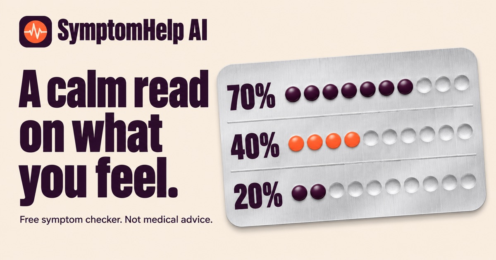

# SymptomHelp AI

An AI-powered symptom analysis tool that provides health insights based on your symptoms. Built with Next.js and powered by Google Gemini. For informational and educational purposes only — not a substitute for professional medical advice, diagnosis, or treatment.

## Features

- Describe symptoms in natural language and get instant AI analysis
- Condition matching with confidence scores and severity levels
- Urgency indicators with recommended actions
- Optional age and gender inputs for more accurate results
- Firebase Auth sign-in (Google and email/password) required to run an analysis
- Per-user history and saved profile (age, sex) in Firestore
- Fully responsive design for all devices
- Dark mode support
- SEO optimized with structured data, sitemap, and Open Graph tags

## Author

**Ashutosh Swamy**

- [GitHub](https://github.com/ashutoshswamy)
- [LinkedIn](https://linkedin.com/in/ashutoshswamy)
- [X](https://x.com/ashutoshswamy_)
- [Portfolio](https://ashutoshswamy.in)

## Setup

1. Create a Firebase project; enable Authentication (Google and Email/Password) and Cloud Firestore.
2. Copy `.env.example` to `.env.local` and fill in the Gemini key and Firebase web app config.
3. Publish `firestore.rules` (Firebase console, Firestore, Rules) so each user can only access their own data.
4. In Authentication settings, add your deployed domain to Authorized domains.
