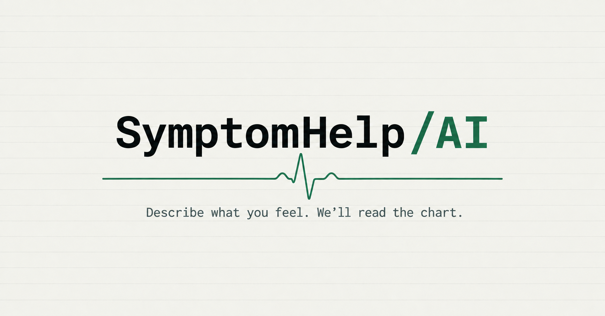

# SymptomHelp AI

An AI-powered symptom analysis tool that provides health insights based on your symptoms. Built with Next.js and powered by Google Gemini. For informational and educational purposes only — not a substitute for professional medical advice, diagnosis, or treatment.

## Features

- Describe symptoms in natural language and get instant AI analysis
- Condition matching with confidence scores and severity levels
- Urgency indicators with recommended actions
- Optional age and gender inputs for more accurate results
- Fully responsive design for all devices
- Dark mode support
- SEO optimized with structured data, sitemap, and Open Graph tags

## Author

**Ashutosh Swamy**

- [GitHub](https://github.com/ashutoshswamy)
- [LinkedIn](https://linkedin.com/in/ashutoshswamy)
- [X](https://x.com/ashutoshswamy_)
- [Portfolio](https://ashutoshswamy.in)
